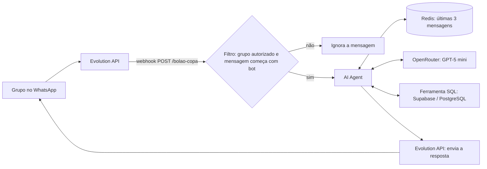
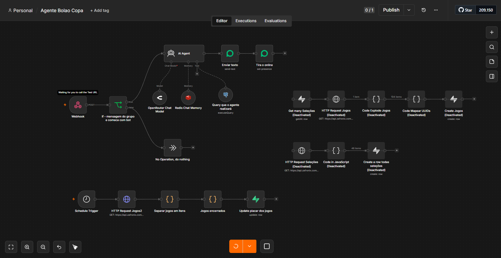
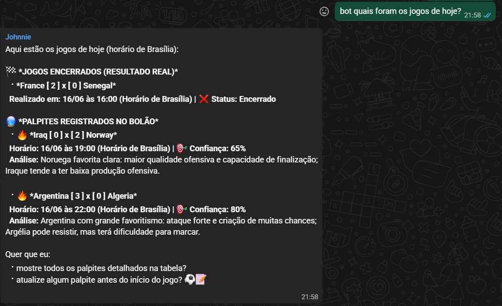

# Agente de IA para Bolão da Copa do Mundo (n8n)

Agente de IA que roda no WhatsApp e ajuda um grupo de amigos no bolão da Copa do Mundo 2026: ele indica o **placar de maior probabilidade** de cada jogo, registra os palpites em um banco de dados e mostra os resultados reais das partidas já encerradas.

Projeto feito com [n8n](https://n8n.io), como exercício de automação com agentes de IA, integração de APIs e persistência de dados.

## Como funciona



1. Uma mensagem no grupo começando com `bot` chega ao n8n por **webhook**, enviada pela Evolution API.
2. Um filtro garante que só o grupo autorizado aciona o agente.
3. O **AI Agent** (GPT-5 mini via OpenRouter) recebe a mensagem e um **prompt de sistema** que define:
   - objetivo e comportamento do agente;
   - esquema real das tabelas do banco;
   - regras para gerar SQL válido (nomes em minúsculas, conversão de fuso para Brasília);
   - formato e estilo da resposta (sem IDs técnicos, poucos emojis, quebras de linha obrigatórias).
4. O agente usa uma **ferramenta de SQL** para consultar jogos e seleções, calcula o placar mais provável, grava o palpite na tabela `palpites` e responde no grupo.
5. A **memória de conversa** fica no Redis (últimas 3 mensagens por usuário), para o agente entender perguntas de acompanhamento.

### Carga de dados e atualização de placares

Além do agente, o workflow tem duas rotinas que alimentam o banco a partir da API [Zafronix](https://api.zafronix.com):

- **Carga inicial:** importa as seleções e os jogos da Copa 2026. Como a API e o banco podem usar nomes diferentes para a mesma seleção (por exemplo `Cabo Verde` e `Cape Verde`, `USA` e `United States`), um nó de código **normaliza os nomes por meio de uma tabela de aliases** e relaciona cada jogo às seleções pelo **UUID**. Jogos com seleção não encontrada são registrados no log.
- **Atualização diária:** uma rotina agendada consulta os jogos, filtra os que já têm placar e atualiza `placar_a`, `placar_b` e `encerrado` na tabela `jogos`, usando o `api_id` como chave. Assim os resultados reais entram sem lançamento manual.

## Tecnologias

| Função | Ferramenta |
|---|---|
| Orquestração | n8n |
| Modelo de linguagem | GPT-5 mini via OpenRouter |
| Banco de dados | Supabase (PostgreSQL) |
| Memória de conversa | Redis |
| Mensagens no WhatsApp | Evolution API |
| Dados da Copa | API Zafronix |

## Modelo de dados

Três tabelas, que o agente conhece pelo prompt de sistema:

- **`selecoes`**: `id` (uuid), `nome`, `ranking_fifa`, `grupo`, `codigo_fifa`
- **`jogos`**: `id` (uuid), `rodada`, `time_a_id`, `time_b_id`, `data_jogo`, `placar_a`, `placar_b`, `encerrado` e `api_id` (id do jogo na API, usado na atualização de placares)
- **`palpites`**: `id` (uuid), `jogo_id`, `placar_sugerido_a`, `placar_sugerido_b`, `analise`, `confianca_percentual`

## Como executar

### Pré-requisitos

- Uma instância do n8n (cloud ou self-hosted)
- Uma instância da Evolution API conectada a um número de WhatsApp
- Projeto no Supabase com as três tabelas acima criadas
- Um Redis acessível pelo n8n
- Chave do OpenRouter e chave da API Zafronix

### Passos

1. Importe o `workflow.json` no n8n (**⋯ → Import from File**).
2. Crie as credenciais em **Credentials** (a lista está no `.env.example`): Evolution API, OpenRouter, Supabase, Postgres e Redis.
3. Troque os placeholders do workflow:
   - `SUA_CHAVE_AQUI` pela chave da Zafronix, nos três nós HTTP Request (header `X-API-Key`);
   - `ID_DO_GRUPO@g.us` pelo ID do seu grupo de WhatsApp, no nó de filtro.
4. Execute a carga inicial para popular `selecoes` e `jogos`.
5. Na Evolution API, configure o webhook da instância para `https://SEU_N8N/webhook/bolao-copa` e ative o workflow.
6. No grupo, envie uma mensagem como `bot palpites para os jogos de amanhã`.

## Limitações conhecidas

- **O palpite é uma estimativa do modelo de linguagem**, não um modelo estatístico treinado. A coluna `ranking_fifa` não é preenchida pela carga atual (fica nula), então a análise depende do conhecimento geral do modelo e dos dados do banco.
- **A API só entrega placar depois do jogo.** Os dados ao vivo exigem o plano pago da Zafronix, então os placares reais são atualizados apenas quando a partida termina (rotina diária).
- **O agente executa SQL livre.** A ferramenta aceita `SELECT`, `INSERT` e `UPDATE` gerados pelo modelo. Em uso real, vale conectar o agente com um usuário do banco de permissões restritas (leitura em `jogos` e `selecoes`, escrita só em `palpites`).
- O filtro por prefixo `bot` e por um único grupo foi feito para uso privado, sem controle de múltiplos grupos ou usuários.

## Estrutura do repositório

```
├── workflow.json    # workflow do n8n (sem credenciais)
├── .env.example     # lista das credenciais e configurações necessárias
├── README.md
└── docs/            # prints do workflow e de uma conversa de exemplo
```




## Autor

Nícolas Pietro Peixoto: [GitHub](https://github.com/NicolasPPeixoto) · [LinkedIn](https://www.linkedin.com/in/nicolas-peixoto-/)
